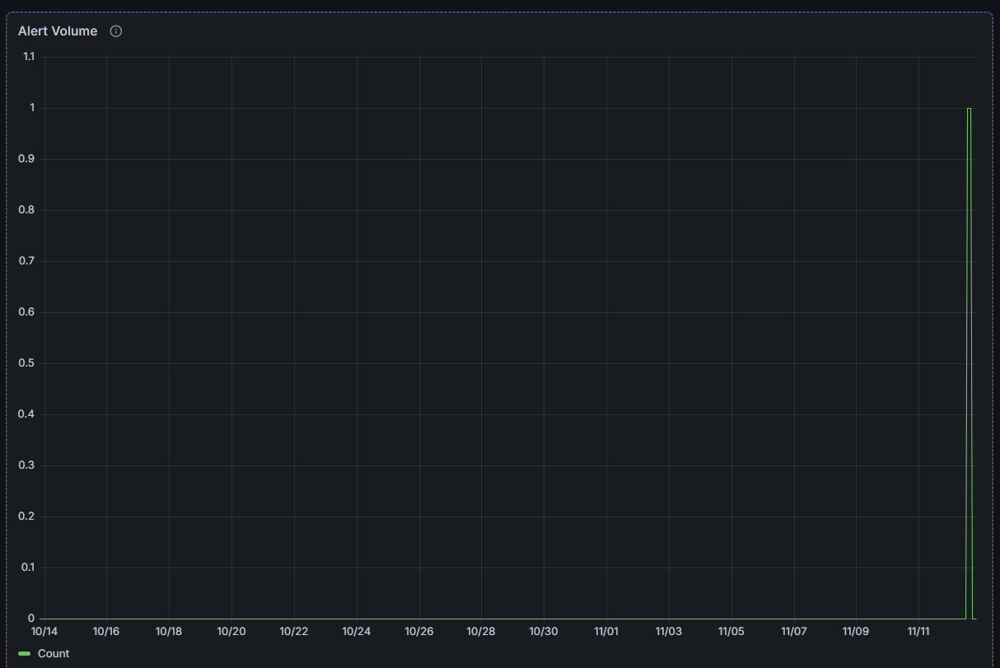
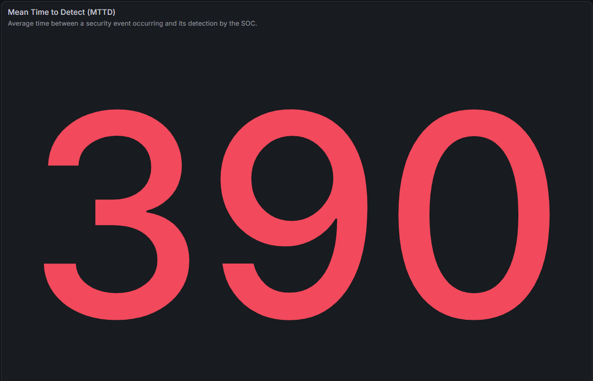
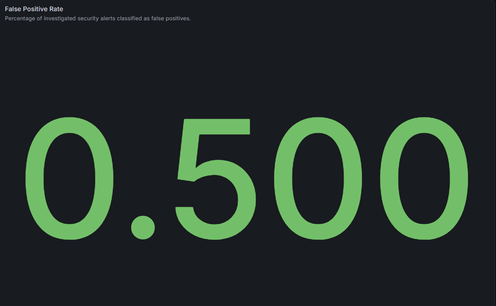

# Project 4: Automated SOC for Riverbend Microfinance Cooperative

**Prepared by:** Mubashir Ahmad

## Project Overview

This project proposes and implements an automated Security Operations Center (SOC) for Riverbend Microfinance Cooperative. Its goal is to improve security monitoring, identify suspicious activity, enrich alerts, automate incident response, and display security metrics.

## Task 1: Design SOC Architecture and Threat Model

**Status:** Architecture and threat model documentation prepared.

### Deliverables

1. **SOC Architecture Diagram**
   - [View Architecture Diagram (PNG)](Diagrams/riverbend_soc_architecture.png)
   - [Edit Architecture Diagram](Diagrams/riverbend_soc_architecture.drawio)

2. **Architecture Decision Log**
   - [View Architecture Decision Log](docs/architecture_decision_log.md)

3. **STRIDE Threat Model**
   - [View STRIDE Threat Model](docs/stride_threat_model.md)

The architecture shows the proposed flow from log sources through collection, storage, security detection, alert enrichment, automated response, and reporting.

## Planned Technology Stack

- Elastic Agent and Elasticsearch
- Elastic Security / Kibana
- Sigma detection rules
- Python alert enrichment
- MITRE ATT&CK mapping
- StackStorm SOAR
- GitHub Issues and Slack notifications
- Grafana dashboards and weekly PDF reporting
- GitHub Actions for detection-rule validation

## Task 2: Automated Sigma Rule Testing


This project uses GitHub Actions to validate Sigma detection rules, generate Elasticsearch SIEM rule JSON files, validate the generated JSON, and test the rules against sample security logs.

### Run tests locally

Install the dependencies:

```bash
python -m pip install sigma-cli PyYAML
sigma plugin install elasticsearch
```

Validate the Sigma rules:

```bash
sigma check sigma
```

Generate the detection JSON files:

```bash
sigma convert -t lucene -p ecs_windows -f siem_rule -o detections/suspicious_powershell.json sigma/suspicious_powershell.yml

sigma convert -t lucene -p ecs_windows -f siem_rule -o detections/powershell_network_connection.json sigma/powershell_network_connection.yml
```

Run the sample-log detection tests:

```bash
python sample-logs/test_detections.py
```

Sample events are synthetic Sysmon-style JSON Lines records created for testing. They are not collected from a real system.

## Task 3: Alert Enrichment Service

This Python service reads alerts from the `riverbend-alerts` Elasticsearch index, retrieves MITRE ATT&CK technique mappings through the OpenCTI GraphQL API, and writes enriched alerts to `riverbend-alerts-enriched`.

### Features

- Retrieves alerts from Elasticsearch.
- Retrieves ATT&CK technique information through OpenCTI.
- Maps technique names to MITRE ATT&CK IDs.
- Adds a `mitre` object containing the technique name and technique ID.
- Writes enriched alerts to a separate Elasticsearch index.
- Includes pytest unit tests with mocked API responses and Elasticsearch operations.
- Includes a Dockerfile for containerized deployment.
- Includes a local demo that uses a static MITRE mapping.

### Project files

```text
enrichment-service/
├── enrich.py
├── demo_enrichment.py
├── requirements.txt
├── Dockerfile
└── tests/
    └── test_enrich.py
```

### Configuration for production mode

Set these environment variables before running the production service:

- `OPENCTI_URL` — Your OpenCTI instance URL.
- `OPENCTI_API_KEY` — Your OpenCTI API token.
- `ELASTICSEARCH_URL` — Your Elasticsearch URL.

For local execution:

```text
ELASTICSEARCH_URL=http://localhost:9200
```

For a container connected to `riverbend-network`:

```text
ELASTICSEARCH_URL=http://riverbend-elasticsearch:9200
```

The source index is `riverbend-alerts`, and the output index is `riverbend-alerts-enriched`.

Do not commit real API keys or secrets to GitHub.

### Install dependencies and run unit tests

From the repository root:

```bash
python -m pip install -r enrichment-service/requirements.txt
python -m pytest -v
```

The unit tests mock the OpenCTI HTTP response and Elasticsearch operations. They do not require a live OpenCTI instance.

### Run the local enrichment demo

The demo uses a static mapping:

```python
{
    "Valid Accounts": "T1078"
}
```

It reuses the enrichment logic in `enrich.py` and writes the enriched alert to the real local Elasticsearch instance. It does not require OpenCTI credentials.

Make sure Elasticsearch is running and that the `riverbend-alerts` index contains a sample alert.

From the `enrichment-service` directory, run:

```bash
python demo_enrichment.py
```

Expected output:

```text
Starting MITRE ATT&CK enrichment demo...
Successfully enriched 1 alerts.
Output index: riverbend-alerts-enriched
```

### Build the Docker image

From the `enrichment-service` directory:

```bash
docker build -t riverbend-enrichment-service .
```

### Run the production Docker container

The production container requires valid OpenCTI credentials and an Elasticsearch container accessible through the Docker network.

Create a `.env` file in the repository root:

```text
OPENCTI_URL=https://your-opencti-instance
OPENCTI_API_KEY=your-opencti-api-key
ELASTICSEARCH_URL=http://riverbend-elasticsearch:9200
```

Replace the example OpenCTI values with your actual configuration. Do not commit this file.

From the `enrichment-service` directory, run:

```bash
docker run --rm --network riverbend-network --env-file ../.env riverbend-enrichment-service
```

### Verify enriched alerts

Check the source alerts:

```bash
curl.exe "http://localhost:9200/riverbend-alerts/_search?pretty"
```

Check the enriched alerts:

```bash
curl.exe "http://localhost:9200/riverbend-alerts-enriched/_search?pretty"
```

An enriched alert should contain a `mitre` object similar to:

```json
"mitre": {
  "technique_name": "Valid Accounts",
  "technique_id": "T1078"
}
```

### Testing and demonstration results

- Five pytest unit tests passed.
- Sigma sample-log detection tests passed.
- Docker image built successfully.
- Docker-to-Elasticsearch connectivity was verified.
- The local demo successfully processed a sample alert and wrote the enriched document to Elasticsearch.

**Important:** The local demo uses a static mapping to demonstrate the enrichment and Elasticsearch write process. The production service uses the OpenCTI GraphQL API to retrieve technique mappings.

## Task 4: Automated SOAR Playbook with StackStorm

The StackStorm Elasticsearch polling sensor triggers the `create_issue_and_notify` workflow when it detects an enriched high-severity alert (severity ≥ 8). The workflow automatically creates a GitHub issue and sends a Slack notification containing the alert details and issue URL.

**Execution evidence:** Slack action returned `status: succeeded` with the log message: `Slack notification sent successfully`. GitHub issue creation was also verified (Issue #1).

## Task 5: SOC Metrics Dashboard and Automated Reporting

### Overview

Grafana is connected to Elasticsearch to display important SOC performance metrics. The dashboard helps security analysts understand alert activity, detection speed, response speed, and false-positive rates.

The dashboard is named **Riverbend SOC Metrics Dashboard**.

### Dashboard Metrics

The dashboard contains four panels:

#### 1. Alert Volume

Displays the total number of alerts over time.



The dashboard currently uses four synthetic demo alerts for testing.

#### 2. Mean Time to Detect (MTTD)

Measures the average time taken to detect a security event after it occurs.



- Average: 390 seconds
- Equivalent to: 6.5 minutes

#### 3. Mean Time to Respond (MTTR)

Measures the average time taken to respond to a detected security alert.


- Average: 975 seconds
- Equivalent to: 16.25 minutes

#### 4. False Positive Rate

Measures the percentage of alerts that are incorrectly identified as security threats.



- False-positive alerts: 2
- Total demo alerts: 4
- False-positive rate: 50%


### Live Grafana Dashboard

[Open Riverbend SOC Metrics Dashboard](https://fares-types-composite-boring.trycloudflare.com)

The dashboard is hosted locally and made accessible through Cloudflare Quick Tunnel. Grafana authentication is enabled.

**Availability note:** The public URL works while the laptop, Grafana Docker container, and Cloudflare Tunnel are running. The temporary URL may change when the tunnel is restarted. Elasticsearch is not exposed publicly.


### Dashboard Configuration

- Visualization platform: Grafana
- Data source: Elasticsearch
- Elasticsearch index: `riverbend-soc-metrics-demo`
- Dashboard configuration: [dashboard.json](dashboard.json)

The four demo records contain synthetic training data. They demonstrate how SOC metrics can be calculated and displayed; they are not real operational security statistics.

### Automated Weekly Reporting

The reporting component will use Python and Grafana's rendering API to generate a weekly PDF report.

The report will follow this filename format:

`riverbend-soc-report-YYYYMMDD.pdf`

GitHub Actions will be configured to run the report generation script on a weekly schedule and upload the generated PDF as an artifact.

### Deployment

Grafana and Elasticsearch are currently running as Docker containers connected through the `riverbend-network` Docker network.

The live Grafana deployment and reporting automation will be documented here once completed.

## Security Note

This project is a proof of concept. Synthetic logs should be used during development. Production deployment requires appropriate access controls, secure API-key handling, data protection, and security testing.